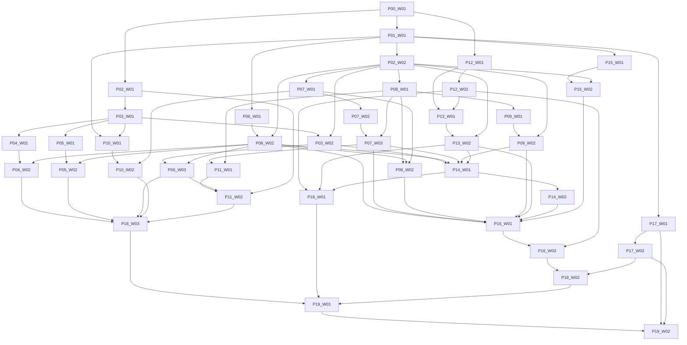

# Dependency graph

A package may be developed against a documented service contract before integration dependencies pass, but may not receive SOFTWARE_PASS until those dependencies and all relevant tests pass. A blocked external account does not block unrelated local packages.
